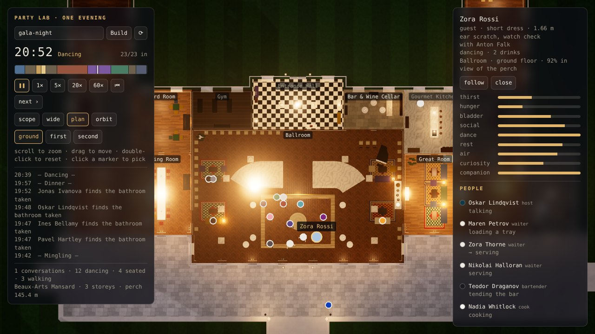
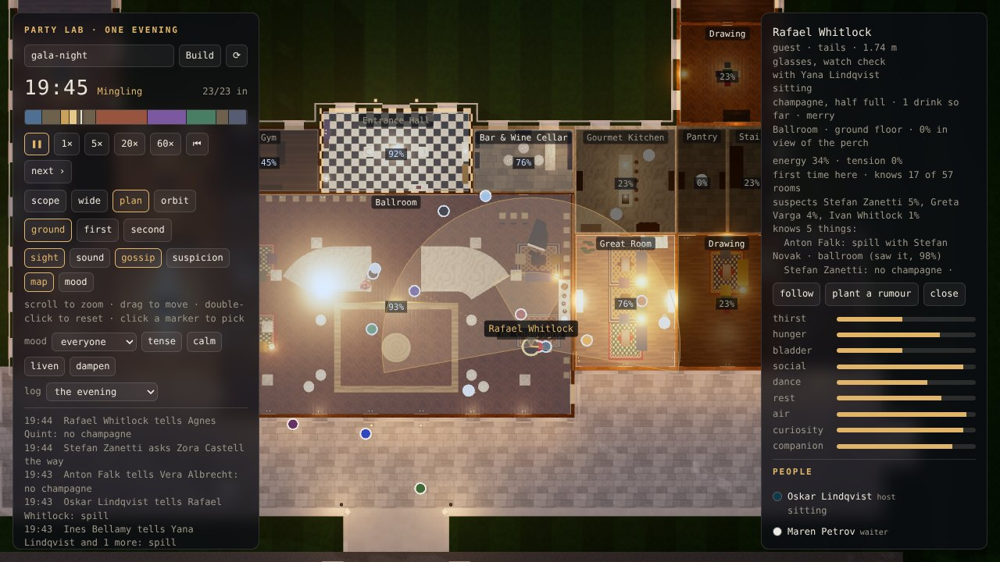
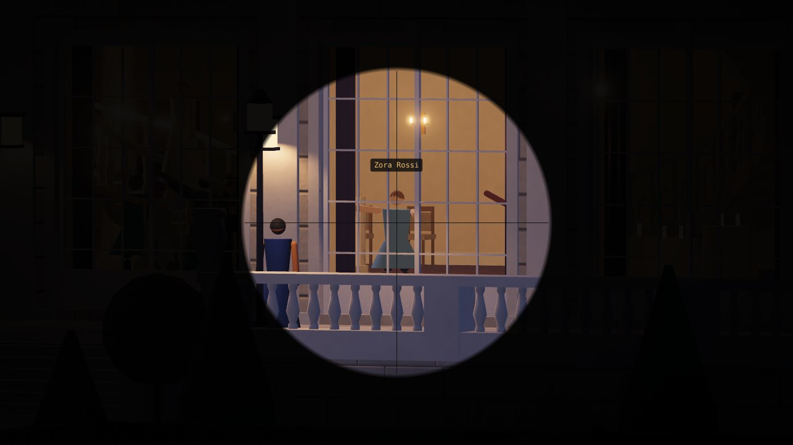

# The party

`src/party/` plays one evening at a generated mansion: 20–30 guests, the staff and a host, through a fixed programme from 19:00 to 22:00. It is milestone 1 (party core) of the design spec, [Guests and the Spy](https://claude.ai/code/artifact/e2c50e9e-e5fd-40d7-ba1f-e5b112831f52), plus milestone 2 ([milestone 2 plan](https://claude.ai/code/artifact/51e90a8d-8fe8-46ef-bbf4-b123ab4e2ebe), [technical plan](https://claude.ai/code/artifact/4a53e787-fa10-481d-a66b-d0db163eca77)). Things: doors that lock, curtains, light switches, glasses and coats, bathrooms with a queue, six drinks and tipsiness. Minds that notice: sight and hearing, what each person knows and passes on, suspicion, the house as each person knows it (wrong turns, asking the way), the mood, knowing each other by sight, and the register in which guests connect the dots. Everyday life: what the house offers, conversation circles, the evening's rituals, errands, tours, searches, the photographer and the band, and a staggered goodbye. Ties: flirting, couples, friendships, affairs, rows and fallings-out. Trouble: mishaps, a few oddballs and the evening's small dramas. Milestone 3 ([plan](https://claude.ai/code/artifact/68947424-84c2-4a3a-875a-39de07a902c9), [technical plan](https://claude.ai/code/artifact/4ad4277a-d8d9-4ba2-894e-9d8eec7d2324)) has begun: the spy arrives, as itself or as someone it killed before the party, and lives the evening as an ordinary guest. Its slips, its goal and the endings come next.



```ts
import { generateMansion } from './src/mansion';
import { Party } from './src/party';

const party = new Party(generateMansion({ seed: 'gala-night' }));
party.advance(95 * 60);          // to 20:35
party.people[7].action?.id;      // 'dinner'
party.visibility(party.people[7]); // 0..1, from the perch visibility grid and the curtains as they are now
party.people[7].drinkLog;        // [{ drink: 'champagne', t: 1312 }, { drink: 'red', t: 3020 }, …]
party.world.doors[3].locked;     // doors, curtains, lights and items
party.body.stats;                // bathroom, bar and bump counts
party.stats;                     // { told, overheard, doubleTakes, tests, wrongTurns, asks, hushes, … }
party.familiarity(party.people[7], 4); // 0..1, how well they know room 4 now
party.suspects(7, 12);           // 0..1, how much person 7 suspects person 12

const evening = new Party(generateMansion({ seed: 'gala-night' }), { spy: true });
evening.spy?.record.name;        // whose record it lives in tonight
evening.spy?.setup;              // 'self', 'victim', 'host' or 'waiter'
evening.spy?.goal.kind;          // 'kill', 'statuette', 'safe', 'bag', 'bug' or 'ledger'
```

The same blueprint and seed always give the same evening. Everything is plain data, so a run can be stepped headless, hashed (`party.digest()`) and replayed.

## Time

The party is 3 in-game hours played in 1 real hour (`TIME_SCALE = 3`). Only the clock is compressed: people walk at real speed, so a sim step of `dt` in-game seconds moves them `dt / 3` seconds' worth of distance. The sim steps every 0.5 in-game seconds, six times a real second at 1×.

| Phase | Nominal start | Length (min) |
|---|---|---|
| Arrival | 19:00 | 15 |
| Mingling | 19:15 | 15 |
| Champagne | 19:30 | 6 |
| Toast | 19:36 | 6 |
| Mingling | 19:42 | 18 |
| Dinner | 20:00 | 40 |
| Dancing | 20:40 | 30 |
| Evening games | 21:10 | 25 |
| Mingling | 21:35 | 10 |
| Last toasts and departures | 21:45 | 15 |

Each boundary moves by up to 3 minutes per seed (less around the short champagne and toast). Each person also notices a new phase 20–150 s late, so the room never moves as one.

## How a guest decides

Guests run a needs-based utility AI, in the style of The Sims. Nine needs run down over the evening at rates set by each guest's traits: thirst, hunger, bladder, social, dance, rest, air, curiosity, and being near one's partner. When a guest is free, they list what they could do now (join or start a conversation, get a drink, the bathroom, sit, look at the art, go out on the terrace, dance, play a game, wander, toast, dine, leave) and score each one:

```
score = phase weight × need term × personal modifier × distance penalty × jitter
```

The best option of each kind competes, then the choice is a weighted draw among the top five (weight = score²). The phase weights carry the programme: during the toast the only other option is a trip to the bathroom, at a small weight, and dinner works the same way. An action ends after its duration and refills the needs it serves.

The house is read once into places (`places.ts`): the entrance, the party rooms, the toast spot in the ballroom or dome hall, dining chairs (head of the table first), buffet spots, a grid on the dance floor, the bars, bathrooms with a door spot and an inside spot, sofas and armchairs, the art, the game tables (billiards, cards, piano, cinema), the terrace and the kitchen.

Rules on top of the scores:

- Bathrooms have doors and a queue (see below). A guest skips one they saw shut in the last 3 minutes unless it can't wait.
- Spots, seats and conversation slots are reserved, so nobody stands inside anyone else.
- Couples dance together and sit together at dinner; the host and their partner head the table. Guests the dining room can't seat sit down to supper on the ballroom's sofas and chairs, couples side by side, and the rest eat standing at the buffet.
- Champagne for the toast comes from the nearest waiter with a tray, or from the bar. Someone who never drinks champagne raises whatever they have.
- A trip to the bathroom is seen through a change of phase once the person is inside or in the line; one still on the way gives way to the programme like anything else.
- In the last 20 minutes only an urgent bathroom trip starts (the bathroom may be two floors up at the far end), and from 8 minutes before the end whoever is still here heads home (see Tasks), so everyone has left by 22:00.

## Staff and the host

About fifteen staff work 20 to 30 guests: the butler, 4–6 waiters, the bartender, the cook and a kitchen hand, a cloakroom attendant, a three-piece band and a photographer. The host greets at the door through the arrival, announces each phase, leads the toasts, heads the table and sees the guests off. Waiters load a tray of 6–8 glasses of one drink at the bar or kitchen (champagne before the toast, red or white at dinner, a mix after) and make four stops in the party rooms (the dining room at dinner). At each stop they offer a glass every few seconds to guests within 2.5 m whose hands are empty (more often when they're thirsty, never a drink they don't touch) and take empties onto the tray; an empty tray ends the stop. When champagne is called every waiter fetches a full tray of 10–12 flutes from the nearest bar or kitchen, and through the champagne and the toast they hop from one empty-handed guest to the next. The bartender stays at the bar and the cook in the kitchen. The butler stands with the host at the door, looks over the table before dinner and has a word in the host's ear, stands at the sideboard through dinner, takes the brandy round after, fetches the good whisky for the bar once, and now and then a drink for someone seated who is thirsty. The kitchen hand washes up, brings clean glasses to the bar three times an evening (first at 30 minutes, then every 45–65) and slips out the back for a cigarette. The cloakroom attendant takes coats at the door through the arrival, fetches one for a guest who feels the cold, and stands by the front door with the coats from the farewell's last toast. The band plays softly through the arrival and the mingling, rests for the toast, eats in the kitchen at dinner, plays the dancing with a break in the kitchen midway, and stops at the last toast. The photographer takes candid shots and the group photo (see Tasks below).

## Things in the house

`world.ts` holds the house's moving parts, worked out from the blueprint inside `src/party` (the blueprint and the mansion generator are unchanged).

- **Doors.** One per interior door or double door between two rooms. Each owns the walk-grid cells inside its wall, at least one cell deep, so every route through the doorway crosses them. A door is open, ajar or shut (eased over 1.5 in-game s, half a real second) and locks one of two ways: a bolt drawn from inside, or a key.

  | Door | Starts | Lock |
  |---|---|---|
  | Bathroom | ajar while free | bolt, shut and drawn while in use |
  | Guest bedroom (1–2, nearest the stairs; 2 when there is no cloakroom) | shut, closes behind you | bolt, key left inside |
  | Family bedroom, study | shut and locked | key: the host's ring |
  | Pantry | open | key: the staff ring |
  | Everything else | open | none |

  A bolt opens for whoever drew it and for anyone on its side. Keys are a ring per person (none, staff or host) and at most one lent key.
- **Routes through doors.** A* asks the doors as it expands: a locked door is a wall to anyone who can't open it, a shut one costs a little (about 1.5 s of walking) and a door into a private room costs a lot unless the trip starts or ends there, so nobody cuts through a bathroom or a bedroom. String pulling keeps to the doorways the search used. A route to a room the room graph says is shut off fails at once, without a search. Routes are cached (256, least recently used first) and each reuse checks that the doors it crosses still open for the walker.
- **On the way.** A walker looks 0.6 m ahead: a shut door is pushed open and they wait while it swings; a locked one sends them another way. Bedroom, study and guest-bedroom doors swing shut behind them. Walkers also give way: someone in a lane a metre or so ahead sends them sideways, more the closer they are, so fewer people walk into each other.
- **Curtains.** Every glazed, unfrosted exterior window with curtains, open, sheer or drawn as the blueprint has them. Those of bedrooms, dressing rooms, sitting rooms, the study and the cinema can be moved. `party.visibility(p)` reads them: drawing a room's curtains dims the baked perch view in proportion (drawn lets nothing through, sheer about half), and opening ones the bake had drawn traces that room afresh, once.
- **Lights.** A switch per room, just inside its main door, and an on or off state per room (off leaves 8% from the rooms next door). Bathrooms dark at the start light up while in use.
- **Items.** A table of things with an owner, a holder or a resting place, and a state: glasses (full, empty, set down, cleared), trays, the good whisky, the first-aid kit, coats (hung at arrival in the cloakroom or on a guest bed, worn home), bags, spectacles. What a person holds is an item; `held` is how it looks.

## Bathrooms, drinks and tipsiness

`body.ts` runs what happens to people's bodies.

- **Bathrooms.** A guest walks to the place outside the door. If the bathroom is free they go in; once they're in the room the door shuts and bolts (when nobody else is in there) and the light comes on if it was dark. Otherwise they say so if they didn't know, remember it, and either queue (up to two, along the wall beside the door, when it's urgent or there's nowhere else to try) or go back to choosing. The one at the front knocks after a minute and whoever is inside hurries; a queuer gives up after 2–4 minutes. Anyone who sees a shut bathroom door (within 12 m, in their field of view, nothing in the way) or hears a knock or the bolt remembers it for 3 minutes, and turns back if it is the bathroom they were heading for and they can wait.
- **Drinks.** Six: champagne, red wine, white wine, beer, whisky and water. Each guest has a favourite and about 1 in 5 has one they never touch, most often red wine or beer. The bar pours in turn, 8–15 s a glass, slower with no bartender behind it; people wait their turn. A glass empties over its drink's life (champagne 25 in-game minutes, wine and beer 15, whisky 12, water 10) and is set down on the nearest table within 5 m when it is empty or the hands are needed (dancing, games, the bathroom, dinner, leaving). Everyone keeps a log of up to 24 drinks.
- **Tipsiness.** 0 to 1. Each alcoholic drink adds 0.12–0.2, less for a heavier build, taken in as the glass is sipped; it fades by 0.05 an in-game hour. It raises the bladder's pace (by up to 0.009 a minute) and the urge to dance (by up to 0.025), sets off the dances-after-drink habit, and above 0.6 makes people walk 10% slower and sway. Someone well over the edge is offered nothing but water.
- **Bumps.** Two people overlapping by more than 8 cm while closing faster than 0.6 m/s (a little wider for someone swaying) walked into each other: logged once per pair per 10 s, with a glass more than a fifth full slopping a little at 25% (more when tipsy). They are only counted for now; rows come in a later part.

## Behaviour that names a place

Some behaviour needs a kind of room the house may not have. `places.ts` resolves each one at construction down a chain of fallbacks and records which link it used (`party.places.chains`), so nothing depends on a room that isn't there:

| Chain | Links, first that exists |
|---|---|
| `coats` | cloakroom, the bed in a guest bedroom, the hall console, the entrance |
| `spirits` (the good whisky) | pantry cabinet, kitchen cabinet, the bar, the kitchen |
| `lockAway` | bathrooms and guest bedrooms |
| `proposal` | conservatory, the fountain, the terrace |
| `film` | cinema, or none tonight |
| `act` | theatre, the ballroom's music corner, the ballroom |
| `cards` | card room, a card table elsewhere, the dining table |
| `billiards` | billiard room, or none tonight |
| `lateDance` | disco, the ballroom floor |
| `water` | spa pool, the fountain, or none tonight |
| `note` | morning-room desk, library reading table, a desk or side table in a party room, the ballroom |
| `photo` | foot of the grand stair, the ballroom |
| `dinner` | dining chairs, ballroom supper seats, the buffet |

The census of 36 houses (in the milestone 2 plan) is what the chains were built against; a test resolves them on 12 houses of every size.

## Minds that notice

Five modules, each owning its state in flat typed arrays, read by the minds through `MindWorld` and wired together by `Party`.



### Sight (`sight.ts`, `senses.ts`)

A sight grid per storey (the walk grid's 0.25 m cells; furniture doesn't block sight) marks open floor, wall, doorway, curtained window and screen (frosted glass). A table says which rooms can see into which (a shared opening, a glazed screen, the gallery round an atrium). Each person looks every 2 in-game seconds (a quarter of the party each step). For everyone else present, in this order: the same storey or across the atrium void; within 12 m; rooms that can see each other; the room's range (4 m in the dark to 12 m in full light); 100° either side of where they're facing (their head, during a glance); for someone across the void, a line over the gallery rail; two people standing on the line hide the far one; then a grid walk that stops at walls, shut doors (an open door lets sight through past half open), drawn curtains and frosted glass. Attention decides what is taken in: 0.9 to start, more for the nosy and the tense, less for the tipsy, the lively and anyone busy dancing, eating or talking.

What a sighting does: the looker notes where the other was and what they were doing; within 6 m and 30° of straight ahead they see what's in the other's hand and whether they're unsteady (a fact, `tipsy`); anything notable the other is doing becomes a fact (a wrong turn, a locked door tried, coming out of a bedroom, a spilled drink, no champagne at the raise, being out of step with the toast); and someone they know is compared with how they remember them (see Knowing each other). A bathroom door in view says whether it's taken. Rooms seen into through doorways and glass are learnt a little (once a minute each).

### Hearing (`senses.ts`)

Sounds carry through the room graph by the loudest way (a Dijkstra): 0.5 dB a metre, 6 dB through an open door, 20 through a shut one, 3 through an arch, 15 up or down a stair. A sound is heard when it beats the listener's room noise by 6 dB. Noise is worked out every 5 in-game seconds: 45 dB background, talkers at 55 dB raising their voices over each other (the Lombard effect), the band at 75 and the piano at 70. Heads turn toward what was heard (not for laughter in one's own room); a sound with a tension weight unsettles; a knock or the bolt tells listeners the bathroom is taken; a loud sound (80 dB and up) in another room sends a nosy guest to look.

| Sound | dB | | Sound | dB |
|---|---|---|---|---|
| knock | 58 | | dropped tray | 65 |
| bolt | 50 | | breaking glass | 80 |
| clink | 50 | | slap | 80 |
| laugh | 65 | | door slam | 80 |
| raised voice | 65 | | scream | 95 |

This part only makes knocks, the bolt and laughter; the rest are for the mishaps and rows to come.

### Facts and gossip (`memory.ts`)

A fact is a verb (24 of them: romance, odd acts, mishaps, the house, requests, whereabouts), a subject, an object and a room, each with a juiciness, an oddness and a half-life (90 minutes for romance, 45 for odd acts, an hour for mishaps, 20 minutes for the house). The same thing seen again within a minute of its last sighting is the same fact. Each person holds up to 48, each with a confidence that halves over the fact's half-life (half again as long about a friend or partner), who told them and in how many hops; a full memory drops the weakest (confidence × juiciness).

When a conversation's speaker changes, the new speaker passes something on with chance 0.25 × (0.4 + talkativeness): one of their three best facts (by juiciness × confidence × listeners who haven't heard it, doubled when it concerns a listener's friend or partner), never about anyone in the group, and a dull fact only with a chance equal to its juiciness. Listeners learn it at 0.8 of the speaker's confidence, and anyone standing within 3 m overhears it at 30%. Nothing below 0.2 is passed on. At a table, in the toast ring, on a sofa or out on the terrace, people also say something to whoever is within 1.6 m now and then (0.02 × (0.3 + talkativeness) every 2 s).

### Suspicion

Learning an odd fact about someone raises suspicion of them by oddness × confidence × (1 + one's tension), less for a friend (× 0.5) and far less for a partner (× 0.2). It halves over 40 minutes. At 0.35 a person is wary: they glance at the one they're wary of when close, and don't seek out a quiet word with them alone. At 0.55 they suspect: talk stops for 10–25 s when that person joins their conversation (a hush), and a group with that person in it is half as inviting. In this part nobody is anything but innocent, so suspicion stays low (under 0.2 by the end of an evening) unless the lab plants a rumour.

### The house as each person knows it

Each person knows each room from 0 to 1. Walking into a room adds half of what's left (less when tipsy); seeing into it a tenth. Knowledge halves toward a floor over 45 minutes (faster when tipsy); each visit raises the floor by 0.45, up to 0.6 and never above what was learnt, so a room visited once stays known and one visited twice is never got wrong. The host and their partner never forget. Starting knowledge: everyone knows the entrance hall and the rooms off it (0.6); about a third of the guests are regulars who know the party rooms and the two bathrooms nearest the toast spot and the way to them (0.8); staff know the whole house (0.9, bedrooms and the study 0.3).

What it changes:

- Options aimed at a room someone doesn't know (below 0.3) are left out, except the programme's own (champagne, the toast, dinner, leaving), wandering, and a bathroom when it's desperate.
- Wrong turns. Entering a room on the way somewhere, with k the better of how well they know where they're going and the next room on the way, the chance of a wrong turn is (0.5 − k)(1 + tipsiness), at most once in 2 minutes. They walk into the wrong room or up to a locked door (`locked-door`, a fact for whoever sees it), look round for 2 s, and set off again.
- Asking the way. Someone who needs a bathroom and knows none asks someone they know, or the staff or the host, on their storey and seen in the last minute (the household and staff count as nearer). The answerer points the way (the rooms along it become 0.3 better known and the bathroom 0.4) or shrugs. Someone who wants to put a friendly test to a friend (see below) uses the same action.
- Showing the way. When dancing or the games are announced, the host shows everyone the way: the rooms along it become better known and the room itself 0.5.

### Mood (`mood.ts`)

Energy and tension per person, updated every in-game second; a room's mood is worked out from whoever is in it, only when asked. Energy drifts (5-minute time constant) toward 0.25, plus 0.35 dancing, 0.15 with music in the room, 0.2 × tipsiness, 0.1 talking in a group and up to 0.2 for a crowd within 3 m, minus 0.2 sitting alone; pairs within 3 m in the same room pull each other's energy together. Tension comes from what people see and hear, halves over 20 minutes, and passes from tense people to calmer ones beside them (scaled by their nerves), never the other way. A room is tense from 0.35 average tension, uneasy from 0.15, else festive from 0.45 energy, else relaxed. Energy makes dancing more tempting (× 0.6 + 0.8 × energy); tension pulls people toward their friends and partner (× 1 + tension), sharpens attention and makes odd facts count for more. In this part little raises tension (hearing something juicy and odd, a little), so it stays near 0 unless the lab sets it.

### Knowing each other (`ident.ts`)

Ties come from the cast (partners 5, friends 3 or 4, the staff among themselves and with the host 3, the host and each guest 2, or 3 for a regular, regulars among themselves 2, and about half of one's friends' friends 2) and from meeting in a conversation tonight (1). Each person remembers how everyone they know looks: height, build, walk, voice, habits, the colour of their clothes. Each sighting compares, more closely face to face (within 1.5 m) than across a room, less in the dark or with drink taken. A difference they can't explain grows into doubt (weighted by how well they know the person); one they can explain (they saw them drinking, or know they're tipsy) counts a fifth as much and is got used to. At 0.2 doubt they look twice (`double-take`, a fact); at 0.45 they try a nickname or a shared joke when next face to face (`test`). The real person passes, after which they're themselves for the evening; very drunk (past 0.7) they fumble it one time in seven, and pass the next. Doubt fades, the slower the surer they've been since last reassured: it halves over 15 minutes at a double take and twice as long for every 0.2 more, about 35 minutes at 0.45, an hour at 0.6, over two hours past 0.85. Something striking makes it fade three times slower still (milestone 3: a name they should have known, a scene, a word from someone sure, the garment found), so an odd moment is explained away within the hour and a shock stays with them all evening. A test passed settles it: what's left fades as a small doubt does. Milestone 3's spy bluffs or fails one, and past a test doubt can grow on (see The spy, Seen through).

### Connecting the dots (`register.ts`)

Beside their facts, each person keeps a register: up to 48 sightings (who was where, from when to when), 16 claims (what people say of themselves: "I was on the terrace") and 8 cases (something that wants explaining, with up to 6 candidates). Sightings and claims share one record: who (or, for someone they couldn't name, a description of sex, height, build, clothes and habits), what, the room, a window of time, how sure, who told them, the original witness and the hops. That one shape lets any kind of case use any kind of evidence.

A case is opened from a template:

| Case | Opened by | Matches on | Severity | Settles at |
|---|---|---|---|---|
| Thing gone | noticing or hearing something is gone (looks back 20 min) | place and time | 0.6 | 0.6 |
| Person gone | someone missing | place and time | 0.5 | 0.6 |
| Lights out, door locked | the house facts | place and time | 0.15, 0.1 | 0.6 |
| A crash | a loud sound | place and time | 0 | 0.6 |
| Cheating | a cheating hint | the pair | 0 | 0.52 |
| Not themselves | two firm sightings that can't both be true | doubt | 0.05 | 0.6 |

How a case weighs its candidates: each entry fits by room (same room 1, a room joined to it 0.4) times time (1 when the windows overlap, 0 at 10 minutes apart), times how sure it still is (halving over 45 minutes), times how far the source is believed (own eyes 1; someone told them 0.3 + 0.6 × the tie, times their belief in the teller; a forgotten source 0.3). One vote per original witness, so a story heard three times counts once. An unnamed description spreads half its weight over the known faces that resemble it. A claim that puts someone elsewhere takes off up to half; one that explains them being there (an errand) clears them. P = weight / (all weights + 0.5). A case settles when the leader reaches its line and the next is under half of it. The holder, the subject and, for the household's things, the household are never candidates.

Order doesn't matter: a sighting filed before the case opens is found by the case (hindsight), and one heard after it feeds it (forward). A description that later meets a name (being introduced in a conversation) is re-checked and can resolve to that person (`recognised`).

When a case settles, the holder blames the leader (a `blamed` fact, passed on as gossip), grows suspicious of them by severity × P × (1 − trust), only ever the rise, and keeps away. A guest who knows the host (tie 2 or more) goes and tells them about the host's own things, half the time, within 30 minutes (`tell`).

Things that don't fit:

- Two places at once. Two entries put one person in two rooms that can't both be true: the stretches they were surely there overlap by 2 minutes or more, or one whole window sits inside the other's sure stretch. The weaker entry gives way (its confidence halves) and the teller is believed less (up to 0.2 a time, back over an hour, never under 0.2). If both are firm and one is the holder's own eyes, they doubt it's really that person (`not themselves`, doubt + 0.15, suspicion + 0.05).
- A broken claim. Someone said they were on the terrace; the holder saw them in the study: suspicion by the severity of the case it answered (0.1 if none), and the claim counts for little after. A second broken claim is treated as two places at once.

Drink adds noise when something is filed: the window widens by 1 + 6 × tipsiness minutes, its centre drifts (σ 4 × tipsiness min), the room slips to a joined one at 0.3 × tipsiness, a description loses a feature (colour, then build, then height) with chance tipsiness, and who said it is forgotten at 0.5 × tipsiness.

Talk: a person with an open case of severity 0.3 or more asks around in their conversation (every 10 minutes at most, 0.5 × (0.4 + talkativeness) a turn); everyone there learns the case, and whoever holds something that fits says so to all (up to two entries each, including their own last sight of people). A holder whose leader is at 0.3 or more passes on that lead (0.3 × talkativeness). Whoever notices something gone tells everyone within 6 m in the room. Joining a conversation, a person may say where they've just been (a claim; 0.3 × (0.4 + talkativeness)).

Evidence travels, never a bare verdict: a listener weighs what they hear for themselves.

## Everyday life

### What the house offers (`ads.ts`)

Each kind of object, room or place advertises what it does: the needs it refills, for how long, the pose, the phases it suits and who takes to it (the elderly to a fire, the young to the fountain, a smoker to the terrace). The table resolves at the start into this house's offers, one per object with its standing spots, so a new activity is a row, not new code, and a room a house lacks offers nothing. Art, the fireplace, the library shelves, a globe, the atrium rail, the plants, the pool, the fountain, the kitchen (counters, the bustle, a word with the cook), the buffet, sofas and chairs, the terrace, billiards, cards, the piano and the cinema.

### Conversation circles (`groups.ts`)

A circle stands in an F-formation: members on a ring round an empty middle, facing in (radius 0.45 m for a pair, 0.45 + 0.12 m a member above that), a pair face to face. A newcomer walks to the widest gap at the edge (counting others already waiting there), waits 2–6 s, and the circle opens and shifts to make room, or stays closed and they walk off and keep away from it for 10 minutes. The shy may linger a while longer at a closed circle (the party ghost). How open a circle is depends on the members' ties to the newcomer, a friend or partner inside, its size, and any suspicion of them; someone they're wary of is let in only now and then, and the talk stops when they are (a hush). Above four in a quiet room, or three in a loud one, a circle splits at its next turn: those on the far side from the speaker form a new circle a clear step away, wherever round it there's room. A new conversation isn't started on top of one going. Each member stays 5–15 minutes (longer with a partner or friend, shorter with the bore). People who know each other greet when they first see each other tonight: a wave, the approach, a handshake or a kiss.

### Rituals (`practices.ts`)

The evening's beats fire at points in the programme and for a while pull on what people choose (a multiplier on a choice, never an order): a spoon on a glass and the hush before the speech; the procession to table; the host sits first; the table turns to talk the other way; the host couple's opening dance alone for a minute, then the surge onto the floor; the band's break, when the bar fills; last call 20 minutes before the end; the host's thanks. Two norms: whispering through the speech and sitting before the host. Up to four proper people nearby frown, glance over and remember it as rude, once per person and norm.

### Tasks (`tasks.ts`)

Jobs of a few steps (go to, meet, say, wait, unlock and lock, pick up, hand over) for one person or a small party following in single file. Everyone in a task is busy; a task gives way to the toast and dinner.

- **Tours.** The host shows one to three guests who don't know the house (the plus-one first) three to six rooms they don't know, unlocking a key-locked door on the way in and locking it on the way out; at most four an evening, 20 minutes apart, offered at two in five of the host's free moments with such a guest close by and free.
- **Errands.** The good whisky to the bar, clean glasses, a coat, a drink for someone. The carrier sometimes tries the wrong room first. A fetched drink is carried as a glass and handed over, so the asker holds it and drinks it.
- **Searches.** Someone who hasn't seen their partner for 17 minutes (the plus-one after 9) goes to the room they last saw them in and looks round; at most twice an evening, and not while the other is already looking for them. Most find them.
- **The photographer.** Candid shots from the edge of the busiest room, every 3–5 minutes. After the toast, the group photo: everyone lined up by height before the grand stair, the tallest at the back, the host couple in the middle of the front row; three flashes, then a few crowd round the camera.
- **Leaving.** Each guest has a hidden threshold, skewed low: from the farewell's last toast they go once that share of the guests has gone, so a few goodbyes tip the rest. The elderly tire and go during the dancing, and now and then someone has a babysitter or feels unwell. A couple goes together: find the host to say goodbye, collect a coat from the attendant at the door, and out. From 8 minutes before the end whoever is left goes at their own moment, and from 5 minutes the rest hurry.

## Ties (`bonds.ts`)

Ties form and break through the evening. Everything is n × n typed arrays drawn at the start from their own random stream (`bonds`), so adding them shifted nothing else. Growth runs every four steps over the pairs the mood already finds (within 3 m in the same room), and fading is worked out when a pair next meets. The spy, when milestone 3 casts one as a guest, gets all of it like anyone else.

- **Chemistry and affinity.** Every pair draws a chemistry each way, mostly shared (attraction tends to run both ways or neither): the flirt and the young are drawn more, the mother and the elderly less, and same-sex chemistry only between the 6% so inclined. Affinity is symmetric: like talks to like, dancers to dancers, a shared habit, a friend in common.
- **The cast's bonds.** Friends start at 1.3–1.5 (close friends 1.5–2), partners at 2, people who know each other at 0.3–0.9. About half the guests come as couples (the cast's couple chance was compounding to nine in ten; it is now 0.25 a still-single guest).
- **Flirting** grows from chemistry × closeness × what they're doing (dancing most, talk, the bar, a game, sitting side by side) × (1 + tipsiness) × the room's energy, and halves over an hour apart. At 0.15 they notice each other (a glance), at 0.35 they flirt: if either has little chemistry (under 0.2) the cool one steps back and that's the end of it tonight (a rebuff, a small grudge); otherwise they flirt (on the floor they dance close), and during the dancing one may ask the other onto the floor. At 1 they're a couple: everything else either had going stops, and those who see them together get the news.
- **Who may flirt.** Two single guests, never the host, the household, staff (see below) or exes. A stray (about one couple in ten has a partner who strays, the less loyal of the two) may flirt too, but only out of their partner's sight (not in the same room, not seen for 30 s) and with none of the partner's close friends within 4 m. A stray arrives with an eye on one single guest: they drift away from their partner, seek that one out (a circle with them in it scores 4 more; on the floor they dance near them), and go over for a word when they spot them with the partner away. Their flirting grows 2.2 times faster and is an affair from the flirting line; it never becomes a couple.
- **Staff** flirt only while serving a guest close by (a tray stop, across the bar), and at the flirting line they're friends for the night: that guest is served first. One evening in three or four.
- **Friendship** grows from affinity × closeness × what they're doing (talk most, sitting, a game, the bar, dancing) × drink and energy, half again with a friend of both in the same circle. At 0.3 they're acquaintances, at 1 friends (they go into each other's friend lists, and recognise each other as such), at 1.5 close. A friendship short of 1 fades over 90 minutes apart; a friendship never does.
- **Doubt.** A partner who sees their stray flirting erupts on the spot. Otherwise doubt comes by word: news of cheating from a friend adds 1.15 × how sure the teller was, from someone they know 0.5, from anyone else 0.3 (flirting half that), each teller once; a circle going quiet as they join is a hint (0.1). Only a friend tells a partner; nobody else says it in front of them. Flirting from before a couple got together isn't cheating, to them or to anyone told about it. Doubt halves over an hour. From 0.3 they keep an eye out (they look for their partner sooner and more often); from 0.7 they go and have it out.
- **Confronting.** Found with the one they're thought to be with: an eruption, scaled by how sure they are, their nerves and drink: a pull by the arm, a jealous scene, or a row with an act in it (a slap, a thrown drink, a shove; between two tipsy men a scuffle one time in five). Found alone: a hissed word or a row. Whoever is in the room hears what it's about, and afterwards someone goes: the partner off to the terrace or home, the other two apart. Never on less than 0.7.
- **Grudges** come from a slopped bump, a lost game (more for a heavy loss or a gloating winner), a rebuff, jealousy and gossip about oneself overheard (more from a friend), and halve over 30 minutes. Face to face within 2 m, heat = grudge × temper × (1 + tipsiness) × (1 + tension) × 4: from 0.15 a spat, from 0.35 a row, from 0.6 and tipsier than 0.5 a row with an act in it. A pair rows once in 20 minutes at most and keeps apart for 20–40 minutes after; a bad loser at cards cries foul. Witnesses tense up.
- **Falling out and making up.** A spat costs a friendship 0.15, a row 0.8, an act 1.2; a friendship that drops below 0.6 has ended: both drop each other, mutual friends cool a little toward the one they're less close to, and neither joins a circle the other is in. One that was 1.5 or more may be made up after 30 minutes (a hug).
- **Onto the floor.** A friend seen taking to the floor may pull someone after them (chance 0.25 × the bond, a partner 2.4 times as likely, once a pair in 10 minutes): the dance scores three times higher for two minutes, and they dance beside them. A dancer waves a close friend standing by over. Partners dance face to face (the slow dance), and a tipsy flirting pair club-style, one in front with their back to the other. Someone very proper leaves a floor where that's going on.
- **Slipping away.** Every 10 minutes, a couple (or a stray and their lover, out of the partner's sight) close together and both tipsier than 0.4 may slip off to a guest bedroom that one of them knows, with nobody in it and a lock on the inside: they bolt the door and draw the curtains, and come out 20–40 minutes later, a little dishevelled, which whoever sees them come out remembers. Once a night a couple, two couples an evening at most.

## Trouble (`dramas.ts`)

The evening's innocent trouble: accidents anyone can have, the few oddballs who do one spy-like thing all night, and a handful of small dramas. Innocents make every kind of signal the spy will, for innocent reasons. One scheduler runs it all every 20 steps (10 in-game s). Each mishap, drama or oddball's outing is an episode with a cast, a stage and the tasks it runs (`tasks.ts`, kinds `mishap`, `drama` and `habit`, which see a phase change through). An episode counts as seen once someone outside its cast lays eyes on someone in it; a habit only while the oddball is at it, not on the way there.

**Mishaps.** Each check draws exactly one number per person from a stream of its own (`mishaps`), whatever happens, so nothing elsewhere shifts the rolls. The number is read against each mishap's slice of the hazard: its chance per guest per evening × (0.5 + clumsiness) × (1 + 2 × tipsiness) × (1 + people within 2 m / 4), spread over the share of the evening its context holds (a glass in hand by someone standing for a spill, 3.6% of an evening; walking for an ankle, 5%), so the chances hold per evening. Nobody has an accident at the toast or dinner, in the bathroom, on a task, leaving, arriving or in a row.

| Mishap | Chance | What follows | What stays visible |
|---|---|---|---|
| Spill | 10% | A drink down someone standing within 1.2 m: a stain the drink's colour, a grudge (0.35, + 0.25 with no apology, + 0.2 on a light outfit, twice for a repeat offender). A third of those the host is free to help borrow the host's jacket or shawl and change upstairs (one spill in six over 16 evenings); the rest dab at it by the bar | The stain, or a new outfit colour |
| Cut hand | 4% | A glass breaks in the hand (a crash, glass on the floor until swept): a wash in the bathroom, three minutes longer than a visit, while the doctor, the host or the butler fetches the kit and waits at the door; with no one free they see to it themselves | A bandage, all night |
| Lost glasses or bag | 3% | Put down at the nearest table or seat and forgotten; missed 1–10 minutes later: a search, a crouch to look, asking whoever is near (someone who was there points the way), four places at most. Anyone close may spot it and hand it back. A bag not found at the first look opens a case with nobody to blame (`register.ts`) | An open search |
| Twisted ankle | 2% | While walking: a sit for 4–10 minutes | A limp, 25% slower, for the night |
| Feeling faint | 2% | In a crowd or tipsy: a sit, a friend fanning them, then the terrace | Recovering in view |
| Leaning on a switch | 1% | Within 3 m of it, standing: the room dark 10–30 s, arms out, heads turning, a little tension | Nothing after |
| Dropped tray | 0.3% a check, × (1 − tray fluency) × the crowd | A crash, the glasses broken on the floor, the waiter sweeps up | Glass on the floor until swept |

**Oddballs.** At casting 0, 1 or 2 guests (weights 1 : 2 : 1) get one habit each that mirrors a spy tell and repeats it in plain view. Habits that go out (creep, wanderer, snoop) have their outings spread over the evening, never at the champagne, toast or dinner and at least 6 minutes apart; an outing the oddball is too busy for is let go after 5 minutes. Doors off rooms with people in them count as nearer, so what they do is seen.

| Oddball | What they do | Rate |
|---|---|---|
| The creep | Stands 0.55 m behind someone (preferring the other sex) for 10–30 s, or lingers by a bedroom door. A target who notices (0.3 + 0.4 × nosiness) frowns and steps away, or slaps them (40%) | 2–4 outings |
| The wanderer | Tries 2–4 doors into bedrooms, studies and dressing rooms: a locked one rattles; an open one, a look inside, seen coming out | 3–6 outings |
| The nervous one | Startles (a jerk, a step back, a glance) when someone walks into their room, at most every 20 s | All night |
| The latecomer | Arrives 1–8 minutes after the toast, with no champagne, out of step for 3 minutes. Takes over from the cast's occasional latecomer | Once |
| The snoop | Alone in a room they know with a desk, cabinet, sideboard, console or wardrobe: goes through the drawers for 5–10 s; thinks better of it if someone is there | 4–8 outings |
| The camera-shy one | Turns from every flash, leaves a room the photographer walks into, slips out of the group photo or stands at the back | Every photo |

**The deck.** 13 cards, shuffled at casting; the house drops what it can't hold (the piano with no piano, the photo with a terrace under six spots, the fuse with no dance floor, tears with no bathroom), and 3 to 6 are dealt, each at a time in its window. When the time comes the card looks for people who fit; with nobody it tries again two minutes later, and when its window closes the next card in the deck takes its place.

| Card | Window | Who and what |
|---|---|---|
| The quarrel | second mingling to the third's end | A couple whose tipsiness + 2 × tension + an eye for someone else (0.5 each) reach 0.5: sharp words, then one storms off to the terrace (the other follows 40% of the time) or shuts themselves in the bathroom; 10–25 minutes later they make up (60%), one goes home (30% of the rest), or they keep apart |
| One drink too many | dancing to the farewell | Past 0.85, or from 0.6 after two quick whiskies at the bar: loud singing, then a friend or the host steers them to a seat, a waiter brings water, and they doze; 30% are sent home |
| Tears in the bathroom | second mingling on | Someone who quarrelled or rowed in the last 30 minutes (or tense and nervy): the door shut 10–15 minutes; a friend knocks, waits, and they come out together |
| The long speech | the middle of dinner | A talker on their feet at table for 90–150 s: everyone looks their way, fidgets, checks a watch; near the end the partner tugs a sleeve |
| The lost earring | from the first mingling | A search on hands and knees, one to three friends crouching to help, until a waiter on their round finds it |
| Red wine on the carpet | dancing on | A full red glass in a crowd: two waiters scrub, the host fusses, the guests round it step back |
| The bore | from the first mingling | Holds the floor in a circle; listeners glance away and peel off one by one, with a look at a watch or an empty glass, and avoid them for 20 minutes |
| The early leaver | second mingling | A call, then home; at dinner a waiter clears the empty place |
| The stranger | arrives in the second mingling | Cast with no friends here (a late plus-one, or a gatecrasher); the host greets them stiffly |
| The piano | games on | A guest plays and 3–7 gather round to sing |
| The photo | dancing on | A guest lines up their friends on the terrace for an impromptu photo, the camera-shy at the back |
| The broken vase | from the first mingling | Someone backs into a stand: a smash, the host upset, staff sweeping up |
| The fuse | the dancing | The band's amp blows it: the dance floor's whole storey dark 20–40 s, the band and the dancers still |

The new facts are innocent: a twisted ankle, fainted, broke something, lost something, crying, drunk; and one that is a little odd, camera-shy. A stain, a bandage or a borrowed jacket doesn't make anyone who knows of the spill or the cut look twice (`ident.ts`: the colour and state terms count a fifth, and the memory catches up); on anyone else they do. A limp from an ankle turned tonight is no part of how anyone looks: someone hurt, not someone else. Glass breaking and a vase smashing are loud (and a crash is a fact); a locked door rattling is heard close by.

## The spy (`spy/`)

Milestone 3 puts a spy among the guests. Its first part, "the spy arrives", makes it come and live the evening as an ordinary guest; the second, "seen through", has those who knew the one it plays see through it, and it answer them; its covers, goal plans, the bodies and the endings come in the parts after those. The `spy` option is off by default, and then none of this is built and the evening is milestone 2's but for what innocents do too: the reactions, the friendly test's drunk fumbles, cool greetings, tours asked for and the real host's rare late announcement (below). `new Party(bp, { spy: true })` draws everything; `{ setup, goal, odds, steal, target }` pin parts of it, and a value that doesn't fit (a setup the cast can't give, a goal the house can't hold) is dropped so that draw is made as usual. `party.spy` is the spy: the record it lives in, how it came, its goal, what it knows and what it has given away.

**How it comes (`spy/cast.ts`).** Cast before anyone knows anyone, from its own fork, so every other draw of the evening comes out as it would without it. It comes as itself in 55% of evenings and otherwise as someone it killed before the party: the host in 55% of the evenings the host has no partner, then a waiter one time in ten, else a guest. Over 2,000 casts: as itself 54%, as a guest 32%, the host 11%, a waiter 3%.

- As itself it takes over a guest who came alone, with no archetype, not an oddball or the stranger, rather one with few friends. Nobody here knows it: the record's friendships are cut both ways, it has never been to the house and it keeps the steadier head. When nobody alone is ordinary (8% of these evenings) it takes one whose archetype is only a manner (the young one, the life of the party, the gossip, the bore, the flirt) and drops the manner. In about 3% of casts nobody alone fits at all, and it comes as a guest instead.
- Playing someone, the victim is a guest who is not the host's partner, an oddball or the stranger and has no archetype (the evening's special parts are allowed), much rather someone alone (a partnered guest counts 0.1) with few friends and not a regular.
- Its goal is one of six by the plan's shares, kill 35, the statuette 15, the safe 15, a bag 10, a bug 15 and the ledger 10, with a goal the house can't hold (no safe in a study, no ledger, no mantel or console for a statuette) at 0 and the rest scaled. A kill steals something first half the time: the papers from the target's bag, or their phone from their coat on its hook or their pocket (the host's pocket). The target of a bag, or of a kill that steals from one, is given a bag at the door when the usual draw gives none. The goal waits for its plan (PR 3).
- Its own body and mind are drawn like any guest's with a steadier head: nerves at most 0.3, sociability 0.4 to 0.6, thirst at most 0.35, propriety about 0.8. Playing someone it is the victim's sex nine times in ten, within 15 cm of their height (sd 5 cm) and close to their build (sd 0.15); its skills are its own, 0.2 to 0.5, and it has four knacks nobody else has (a lock, the safe, a quiet kill, palming small things, 0.6 to 0.9). A limp of its own slows it by a quarter.
- Before the party: the victim's body lies behind the topiary or parterre hedge farthest from the terrace lamps (or under the trees), 20 to 90 minutes before 19:00. In a third of those evenings (36% of 2,000 casts) something the victim wore, a scarf, a glove or a pocket square in a colour no outfit has, was dropped as the spy came back in: it lies half under a planter just outside one of the garden doors onto the terrace, where guests going out pass. That is the garment, a trace from the start, which a guest outside may find (see Seen through).

**The swap (`spy/swap.ts`).** Playing someone, the record keeps who the person is to everyone else: the name, the role, the clothes, the partner and friends, the seat, the coat and every memory anyone has of them. Its body and mind become the spy's: height, build, walk and habits, traits, skills, temper (`Bonds.setTemper`) and voice (`Ident.recast`). Having studied the victim it copies what can be copied, the smoking and the favourite drink. Everyone still remembers the victim's height, voice and habits, so the difference shows from the first look through milestone 2's own machinery: the victim's partner's doubt passes 0.2 in the first hour in the test.

**Whom it knows.** Before the party it watched some of its victim's people: an acquaintance 10% of the time, a friend 35%, a close friend 50%, the partner 90%, and each of the staff 80% when it plays the host. Those it knows by sight and name, and believes as close as their tie with the victim; everyone else it learns tonight, by sight only. It greets by its own idea of the tie: the record's for those it believes close and for any tie made tonight, none for anyone else however well they knew the victim, and a greeting takes the cooler of the two ties, so it never kisses a cheek it doesn't know it should.

**Its map.** It has never been here: it knows the entrance hall and the rooms off it as a first-timer does, and the way from the door to each room its goal needs, learnt before it came (0.8). Playing the host it is still one of the household, but its map is its own (`memory.ownMap`), so it can take a wrong turn and ask the way.

**Following the programme (`spy/cues.ts`).** It has no programme of its own. It catches each change from the host's announcement, if it hears it (a 90 dB sound put to the sound model with `senses.wouldHear`, which queues nothing and turns no heads), or from the room moving, if it sees three people acting on the new phase (a flute in hand counts in the champagne). Then it moves with the crowd's tail: 60 to 150 s after an announcement it heard, 1.5 to 3 minutes after seeing the room move, 5 to 15 s after being beckoned in. A change caught while another waits is acted on after its own delay, once the first is. Its phase only ever steps on a cue, and only to the phase running, so it is never ahead of the room; out of earshot and out of sight of everyone it notices after 20 minutes. Playing the host it makes the announcements itself, late, at the household's prompt (see Seen through), and acts on each 5 to 15 s after making it. Playing a waiter, the staff's routine keeps it to the programme.

**People react to anyone out of step (`reactions.ts`).** Innocents are late too, back from the bathroom or kept by an errand, so this runs on every evening, spy or not, every 20 steps through the champagne, the toast and dinner. Anyone still not with the programme 3 minutes after a change (longer than anyone's own lag) carries milestone 2's out-of-step; a partner or friend who sees them beckons them in, and at dinner the host points the way in. Someone in the toast's ring with nothing to raise is brought a flute by the nearest waiter with a tray of them. Each is a gesture and a `react` event. Late though they knew the evening's ways (the host's household, or the spy playing the host), they raise a little doubt in whoever knows them and sees it: 0.08 × tie weight. Because these run without a spy too, milestone 2's golden digests moved with them.

**An ordinary guest.** It sips at 40% of the usual rate and sets a glass down once it has held it 10 minutes; past 0.15 tipsiness it asks for water and takes nothing stronger from a tray but champagne. It never leads a card, faints or is the quarrelling couple; its grudges run at half heat; it strikes nobody and nobody strikes it (a jealous scene with it is words only), and answering someone's grudge it takes the sharp word and apologises, so the row is a spat. No scene, card or partner sends it home early.

**Going home.** Never before the farewell's first goodbye, and then among the first half of the farewell's leavers. Of the guests still here after the first goodbye, it sets off once the share on their way out reaches its moment, drawn evenly over the first half (a quarter on average), so it isn't always among the very first goodbyes; guests gone before the farewell don't count. From the first goodbye it checks every step, so a crowd setting off at once doesn't carry it past its moment, and when the moment comes it drops whatever it is busy with (dabbing a spill, an errand) but waits out the bathroom and a row. Its partner can take it home with them sooner. In the last 5 minutes it goes anyway. Playing the host it walks out at the back of a guest's party already past their goodbye and doesn't come back (a host never goes home); as a waiter, or in the last hurry, it walks out alone. With its goal done (PR 3 on) its moment is drawn afresh over the first half, and a deed done in the farewell keeps it 3 to 6 minutes more; with its goal undone at the first goodbye it gives it up for tonight.

**Seen through (`ident.ts`, `reactions.ts`, `spy/answers.ts`).** The second part. Those who knew the one it plays see the difference through milestone 2's own looks, and now it can tell:

- The friendly test. The real person passes. Very drunk (past 0.7) they fumble it one time in seven, a pause and a laugh, and pass the next. The spy, in someone else's record, bluffs it (four times in ten from someone it studied, one in ten from anyone else) or fails it. A bluff passes on the surface and halves the doubt, but the look isn't remembered, so the doubt climbs again at a fifth of the rate. A failure is a blank look: the doubt jumps to 0.75 whatever the look had built up (past comparing notes, short of sure), the one asking frowns and looks to someone else, and the circle goes quiet for a moment. After that the look has told all it can: staring adds nothing more, so being sure needs something new. A blank look is odd, not a shock: its doubt halves over about an hour and 40 minutes, staying past comparing notes for half an hour and past 0.45 for over an hour, so a second witness has to come in that time. The same pair isn't tested again for 10 minutes. Every test is a `test` event with its outcome; a pass or a fumble ends in a laugh.
- Past a test, doubt goes on up to 1, from what is new: a slip, a refusal, a name not known, the garment, a word from someone else, a confrontation seen. The striking ones (a name not known, the garment, a word from someone sure, a confrontation seen) make the doubt fade three times slower from then on. At 0.6 the doubter wants to compare notes with someone else who knew them well (tie 3 or more): a word in their ear in the circle, or a walk over to one in view, once a pair. The listener's doubt rises by 0.15 × tie weight × (0.5 + their trust in the teller) and they want to test them too; the teller's by 0.05. When the listener had doubts of their own (past 0.45), both take 0.25 more: someone else noticed too, which is what makes most people sure. At 0.85 they are sure (a `challenge` event, `sure`). The timid (nerves 0.6 or more) and the tipsy (0.5 or more) say nothing and keep away all evening (`silent`). A partner, family or a close friend in company has it out with them, out loud (`out-loud`: "who are you? where is she?"): heads turn, those free close by watch for 20 to 40 s, and everyone who sees it learns `confronted` and doubts them by 0.1 × tie weight. Anyone else, or alone with them, backs away (`backed-away`) and tells the host, else the nearest of the staff, else a partner or friend (`told`: the listener doubts them by 0.3 × tie weight × (0.5 + trust)), then goes to look for the real one where they were last seen. Called away on the way, they set off again when next free.
- Manner. The spy greets warmly only those it believes close to the one it plays. Anyone who expected a kiss and got a handshake, or a wave back and got none, doubts them by 0.12 × tie weight (`react` `cool`); someone sulking after a falling-out greets their friends just as coolly. In a circle, one speaker turn in ten that involves someone the one it plays knew and it doesn't know by name adds 0.1 × tie weight and a frown (`name`).
- Skill. Everyone expects what someone did as the cast drew them (`ident.expect`): their skills, and the way round the house (0.95 for the household, 0.8 for the staff, 0.7 for regulars, 0.3 for anyone else). The spy keeps its own skills, and knows the house as a first-timer. A fumble shows for a few seconds, and only to someone with it in the detail of their look (6 m, 30°): keys at a door, a dropped tray, a missed step on the floor or a wrong note at the piano (more often the lower the skill, and on the floor the more drink), a lost frame at billiards, the wrong room first on an errand or a tour, a wrong turn, asking the butler where something is kept. Whoever catches it doubts by 0.15 × tie weight × the skill expected × how far short it falls (all of it at 0.3 short), only when they expected 0.6 or more and can't explain it (drink they know of, a bandaged hand, a turned ankle), and never past a test. So an innocent's fumbles add nothing: what they're seen doing is what everyone expects of them. A partner, family or a close friend frowns, and half the time steps over to help (the keys, the tray, or leading on the floor); a friend or acquaintance looks again, puzzled, and has a word about it later.
- Begging off. Playing someone known for the piano, dancing or billiards (0.6 or more) that it can't do as well (0.15 or more short), it stays off them, having studied them. Asked (the piano card, a wave onto the floor, a dance), it waves it away; the one asking, and anyone who knew them and sees it, take half a slip's doubt and shrug, and those closest ask again 10 to 20 minutes later.
- What it knows (`spy/answers.ts`). Only what it saw. Whom it thinks dangerous starts at its study and rises with its own sightings: a wave to 0.4, coming over to 0.7, a kiss to 0.9, a double take or a whisper with a glance its way (+0.3, while it shows), and what is put to its face, a test to 0.5, a challenge to 1, a name it should have known to 0.4. Past 0.5 they go on its avoid list: it keeps out of their circle, turns down their dance, and finds an excuse within a minute when one joins its circle. Tested, it laughs, changes the subject and leaves the circle within a minute; confronted, it laughs it off, walks to another room, and stays until the farewell all the same. A circle going quiet as it joins sends it back to ordinary life for 10 to 20 minutes. A close friend of the one it plays it didn't study stays at 0 until they show themselves, which lets them near enough to see through it.

**Posing as the host (`spy/posing.ts`, `prompts.ts`).** It doesn't know the programme. The household prompts it at every change: the butler (else the nearest waiter) walks over and has a word in its ear, and anyone who sees it learns `prompted`. It announces 2 to 6 minutes late; the change is held, and the flexible phases after it (the minglings and the games, down to 5 minutes each) give the time back, so the evening still ends at 22:00. With nothing left to give (the farewell) the prompt comes ahead and the announcement on time. It asks the butler where the good whisky and the first-aid kit are kept, offers no tours and turns down seven in ten that it's asked for (`refused-tour`, a smile and "later"), leading the rest by its own map, wrong rooms and all; and at 70% of dinner it leaves the table for a call in the hall or the bathroom. The real host is late too, rarely: in one evening in five one of its announcements comes 1 to 3 minutes late, prompted the same way, drawn on its own fork so it comes the same with the spy off. From 19:30 a curious first-timer in the host's circle asks for a tour, once, and the real host agrees nine times in ten.

**The garment found.** A guest outside may take it in, in the detail of their look (6 m, 30°): a look's chance is its attention × the light (the light through the door, 0.5, or the garden lamps' when brighter) × how near it lies (all of it underfoot, none at 6 m) × 0.02. Whoever knew whose it was learns `garment` with the owner's name, and doubts the one who came as them tonight by 0.25 × tie weight, a striking find (it fades three times slower); whoever is free picks it up and hands it in at the cloakroom (else to the butler), and the trace is gone.

**Counting what it gives away (`spy/measure.ts`).** For the lab, the tests and the sweep; nothing the sim chooses reads it. Its tells are written by its own code as it gives them, with the perch's view of the spot and who picked each up while it showed. This part has two: out of step (a cover, which an innocent can give too) and the garment (a trace). Innocent twins are innocents' notables of the same verbs: out of step, camera-shy, startled, a wrong turn, a rattled door, a fumble, a bandage gone and snooping. `ranks()` scores everyone by the crowd's doubt and suspicion of them, for the lab's ranking (milestone 4 decides how the crowd pools for real). The monitors add the tests: nobody but the spy bluffs or fails one, and nobody fumbles two in a row to the same person.

**Determinism.** Its draws come from children of the `spy` fork, one for each part of the cast (the arrival, the goal, its own body and mind, its study, the garden) and one each for its map, its mind and its cues, so pinning one part leaves the others as they were; the reactions draw from `react` (its fumbles and begging off from `slips`), the tests from `test`, the household's prompts from `host`, and the tours asked for, fumbles on the floor, a confrontation's onlookers and the garden's finds from forks of their own. One blueprint, seed and set of spy options give one evening, and `party.digest()` takes in the spy's line.

## Walking

A* runs on the mansion's walk grid (0.25 m cells, 8 neighbours, no cutting corners), and the path is string-pulled to a few waypoints with an exact grid traversal, so a straight leg never crosses a blocked cell. A walker within 0.3 m of a waypoint cuts the corner to the next one when the way is clear, so two people heading for the same doorway don't stall on one point. Stairs join the storeys; a route crosses one storey at a time through the stair with the shortest detour. Doors gate it all (see Things in the house). People push apart to 0.42 m, never into a doorway that is locked against them, and anyone pushed off their line finds a new route from where they stand.

## People on screen

`render/crowd.ts` draws everyone as simple jointed figures, one `InstancedMesh` per body part (thighs, shins, skirt, torso, shirt front, head, hair, arms, a glass, a tray, a hat, glasses, a cane). The mansion's scoped room lights reach them through a per-person `aScope`. Poses come from the sim (walk, climb, sit, talk with the group's speaker gesturing, drink, toast, dance, the slow dance, the club-style pair, play, serve, smoke, greet, announce, look, knock, argue, hug), and habits show while standing about (scratching an ear, checking a watch, hands in pockets, a big laugh). Gestures go over the pose for a few seconds: a hand out to ask the way, an arm out pointing it, a shrug, leaning in to pass something on, a slap, a shove, a thrown drink, a pull by the hand; heads turn toward a glance or a sound. A glass shows the colour of its drink, someone past 0.6 tipsiness lists slowly from side to side, and a couple back from slipping away shows hair and shirt awry for ten minutes. Trouble adds a crouch (looking for something lost, sweeping up), fanning someone, dabbing at a stain, singing, reading a phone and rattling a handle, and three gestures: a startle, groping in the dark and a look at the watch. A spill leaves a dark patch the drink's colour down the front, a cut a white bandage on the hand, a change of clothes repaints the jacket or dress, and the first-aid kit is a red box in the hand. On the floor, broken glass, a vase in pieces, wine on the carpet and anything lost lie where they fell until someone clears them (`Crowd.setLitter`).

`render/fixtures.ts` draws what moves in the house: door leaves on their hinges (two for a double door) and the drapes and sheers of the windows people can draw, four instanced meshes in all. The mansion builder leaves those out of its baked mesh when asked (`buildMansion(bp, { dynamicDoors: true, dynamicCurtains: (room) => … })`), and with the options off the house is built exactly as before. `ScopedLighting.setScopeScale(room, s)` dims a room's lights for a switch. A plan marker in the outfit's colour shows each person on the storey the plan cuts. Detailed bodies and the full body-language catalogue are milestone 5.



## Party lab

`npm run dev`, then open http://127.0.0.1:5173/party/ (on Pages: `/demo/party/`).

- The clock, the phase, and a timeline of the programme. Click the timeline to jump; going back replays the evening from 19:00.
- Speeds: pause, 1× (the evening in an hour), 5×, 20× and 60×; back to 19:00; next phase. Space pauses.
- Views: scope (from the perch; scroll to zoom, drag to aim), wide, plan (scroll to zoom, drag to pan, one storey at a time) and orbit.
- The people list shows what everyone is doing. Click a name, or a person in any view, to see their role, habits, partner, what's in their glass and how full, how many drinks and how merry they are, their room, how visible they are from the perch, their energy and tension, how many rooms they know, whom they doubt and suspect, the things they know (with who told them and how sure they are), and their needs. The scope follows them; the plan turns to their floor.
- Overlays on the plan, each a toggle: **sight** (the picked person's field of view, the sharper cone for detail, solid lines to who they took in on their last look and dashed to who is in view), **sound** (a ring where each sound was made and lines to who heard it), **gossip** (speaker to listeners, coloured by kind of fact), **suspicion** (how much the picked person suspects each other person, or with nobody picked how suspected each person is on average), **map** (rooms shaded by how well the picked person knows them, unknown ones dark), **mood** (rooms tinted and named festive, relaxed, uneasy or tense), **cases** (the picked person's case rooms outlined, with lines to each candidate and their chance; with nobody picked, how many know of a case in each room), **circles** (each conversation's ring, lines to its members, the speaker marked, and who is waiting or hovering at the edge), **tasks** (lines from each task's owner to its party, with the kind and the step) and **bonds** (couples, flirting with its strength, an affair marked, friends and close friends, those who fell out, grudges as arrows from whoever holds them, and how much anyone doubts their partner; with someone picked, only theirs).
- **Goes missing here** on the card makes something of the host's go missing from the picked person's room; **seen there** has the picked person seen poking round that room. Together they plant a theft for the guests to work out. The card's register block lists the picked person's cases and their candidates.
- **Spark** makes the picked person and the one picked before take to each other (both right at the flirting line); **grudge** gives the one picked before a grudge against the picked person; **cheating rumour** starts word going round that the picked person is cheating on their partner. The card's ties lines show their temper, doubt about their partner, a stray's eye or lover, whom they're drawn to, whom they get on with, whom they fell out with, and their grudges and how hot they run.
- **Spill**, **cut hand**, **faint** and **lose glasses or bag** on the card give the picked person that mishap now; the row below plays any card from the deck now, with the picked person in it if they fit (a quarrel with their partner, the fuse on their storey), else whoever the card picks. The card shows a stain, a bandage or a borrowed jacket, an oddball's habit and how often they've been seen at it, the stranger, and the mishap or drama they're caught up in (and whether anyone has seen it yet).
- **Plant a rumour** on the card: a guest in a conversation hears something juicy and a little odd about the picked person. The **mood** row sets tension (tense, calm) or scales energy (liven, dampen) for everyone, the picked person's room or just them. Both take effect from the next step and are kept, so going back in time replays them where they were made; a new house clears them.
- **The spy** (on by default in the lab; `spy=0` turns it off). Until it is revealed the lab shows its record as the crowd believes it: its own events stay out of the log, its card stays shut, and nobody's map shows (the room count and the map overlay), since the spy's alone would give it away. With someone picked the button asks whether it is them, and scores the guess. The goal odds show from the start, each goal with a switch, a weight and its chance in this house ("not here" for one the house can't hold), and how often a kill steals first; a change builds the evening afresh from 19:00 with the same house, guests and provocations, only the spy cast anew. Revealed, the spy's card under the picked person's says how it came and as whom (and where the body lies), its goal and any theft first, the rooms it knows the way to, the phase it acts on and how it caught it (and how far behind the room it is), whom it studied, its drink, when it means to go, the garment in its colour, whom it thinks most dangerous and why, the close ties of the one it plays it hasn't spotted, the tests put to it and what came of them, who is sure it isn't them and what they did, how often the household prompted it (playing the host), and its tells and innocent twins; its name picks its record, and its row in the people list is marked. The garment lies by its garden door in every view. Tests show in the log without their outcome until the reveal, since only an impostor bluffs or fails one. Under the odds, the ten people the crowd suspects most (the mean, over the guests here, of the larger of suspicion and doubt), from the start; a click picks one, and once revealed the spy's record is marked. **Test them** on the card sends the picked person's closest tie here over to try a shared joke on them now.
- Doors swing and curtains draw as the sim has them. The log lists what's happening, filtered to the evening as a whole, everyday life (greetings, joins and rebuffs, splits, tasks, the photo, goodbyes, breaches and beats), gossip, connecting the dots (cases, asking around, leads, blame, telling the host, conflicts, recognising), noticing (double takes, tests, hushes, a noise gone to look at), romance & rows (noticing, flirting, affairs, couples, friendships, rebuffs, spats and rows, who is sure, confrontations, pulls onto the floor, slipping away, games won), mishaps & dramas (every mishap, drama and oddball at it, with how each turns out, and the lights going out and on), the spy (its arrival, its cues, its answers to being tested or challenged, begging off, giving its goal up and going home, once revealed, and anyone reacting to anyone), seen through (double takes, tests, notes compared, who is sure and what they did, and the reactions: frowns at a fumble, a step over to help, a puzzled look, a shrug, a cool hello, a name not known, the host prompted, a tour put off, something found in the garden), finding the way, the house or the programme. The stats add bathroom and bump totals, what was told and overheard, double takes, tests, hushes, wrong turns and asks, and where the coats and the whisky went in this house, and the everyday life totals: hellos, joins, rebuffs, splits, breaches, tours, errands, searches and how many found their partner, the group photo, candids and goodbyes; and the ties: couples, friendships, flirtations and rebuffs, affairs, who found out, confrontations, spats, rows, fallings-out and makings-up, pulls onto the floor, staff friendships and slipping away; and the trouble: mishaps by kind, the dramas played (and any nobody saw), and each oddball with how often they've been seen at it; and the guests found out of step with the programme, beckoned in, pointed the way and brought a flute, and the host prompted; and seen through: fumbles frowned at and helped with, shrugs, cool hellos, notes compared, people sure, confrontations out loud, tours asked for and finds in the garden. The detail card shows the picked person's task and step.

| URL parameter | Meaning |
|---|---|
| `seed` | House seed (the party uses the same seed unless `party` is given) |
| `party`, `guests` | Party seed; number of guests |
| `t` | Start time: minutes after 19:00, or a clock time such as `20:30` |
| `speed` | 0, 1, 5, 20 or 60 |
| `view`, `fov`, `level`, `zoom`, `px`, `pz` | View, scope field of view, plan storey, plan zoom and pan (metres) |
| `sel`, `follow` | Select a person by index; keep the scope on them |
| `ov` | Plan overlays, comma-separated: `sight`, `sound`, `gossip`, `suspicion`, `map`, `mood`, `cases`, `circles`, `tasks`, `bonds` |
| `gone`, `seen` | Plant a theft: `gone=80:5` (minute, room), `seen=75:11:5` (minute, person, room); first house only |
| `test` | A friendly test, `test=90:16` (minute, person): their closest tie here walks over and tests them; first house only |
| `mishap`, `drama` | A mishap on someone, `mishap=30:21:cut` (minute, person, `spill`, `cut`, `lost`, `ankle`, `faint`, `switch`); a card played, `drama=125:quarrel` or `drama=125:quarrel:16` (minute, card, person; a card that finds nobody who fits, at dinner say, does nothing); first house only |
| `tension`, `energy` | Set everyone's tension (0–1), or scale their energy (0.5–1.5), at time `t` |
| `log` | Log filter: `everyday life`, `romance & rows`, `mishaps & dramas`, `the spy`, `seen through`, `gossip`, `connecting the dots`, `noticing`, `finding the way`, `the house`, `programme` |
| `spy` | `spy=0`: an evening without a spy |
| `setup`, `goal` | Pin how the spy comes (`self`, `victim`, `host`, `waiter`) and its goal (`kill`, `statuette`, `safe`, `bag`, `bug`, `ledger`); one the cast or the house can't give is drawn as usual |
| `odds`, `steal` | The goal weights, `odds=kill:50,bug:0` (a goal left out keeps the plan's share, 0 switches it off); how often a kill steals first, 0–100 |
| `reveal` | `reveal=1` shows the spy from the start |
| `profile` | Time each stage of the step and show the totals under the stats |
| `shot=1&w=&h=&ui=1` | Headless capture (`ui=1` keeps the panels) |

Stills: `npx tsx scripts/render.ts --page party/ --views plan,scope --params "t=115&sel=20&follow=1"`.

## Numbers

Measured on three houses, `gala-night`, `match-42` and `orangery-1` (21–28 guests). The rows the trouble moved were measured again with it; the rest are from before it:

| Measure | Result | Test asks |
|---|---|---|
| A whole evening, headless (21,600 steps) | 4.2–4.4 s on the machine that measured 3.5–4.9 s before the trouble, 40–50% of it seeing; the trouble's own stage 0.03 s | under 15 s |
| Guests holding champagne as the glasses go up | 91–95% | ≥ 60% |
| Guests at the toast, 85% of the way through it | 96–100% | ≥ 70% |
| Guests at dinner, 60% of the way through it | 100%, and every guest with a chair seated | ≥ 90% |
| Guests dancing, halfway through the dancing | 57–82% | ≥ 30% |
| Samples off the walkable floor (a person every 30 s) | 0 of 10,100–11,600 | 0 |
| Guests gone by 22:00 | all | all |
| Bathrooms found taken at the door | 0–4 (milestone 1: 29–64) | under 25 |
| Two people in one bathroom; more than two in a line | never | never |
| Drinks a guest | 4.0–5.3 | |
| Tipsiness at 22:00, median and highest | 0.35–0.57, 0.64–0.75 | mean 0.05–0.7 |
| Bumps an evening, with a drink slopped | 218–350, 15–24 | under 400 |
| A* searches an evening, cache hits | 1,850–2,020, 12–13% | |
| Things passed on in conversation (listeners), overheard | 360–973, 42–263 | over 50 an evening |
| A rumour planted 8 minutes into the second mingling, after the group photo: time to reach half the guests, share at 45 minutes (ten evenings: five houses, two seeds each) | 3–22 min in six evenings; in the other four it never reached half within the hour (mean 33 min, those counted as the hour); 13–100%, 66% on average | judged together: mean 10–35 min (never reaching half counts as the hour); ≥ 30% in all but two, over half on average |
| Highest suspicion anyone holds at 22:00, with nothing planted | 0.03–0.14 | nobody innocent ≥ 0.55; with nothing taken under 0.25 |
| Wrong turns, first hour and last hour | 0–8 and 0–5, 41 and 16 over ten evenings (the late ones mostly tipsy trips to the bathroom) | last hour under 0.7 of the first, over ten evenings |
| Asked the way, pointed to a bathroom | 19–44, 80–95% | over 5, mostly pointed |
| Double takes, tests | 13–31, 1–20 | 1–30, no doubt after a test |
| The register on an evening with nothing taken: entries filed, claims, cases, conflicts | 868–2,965, 40–63, 16–112 (all of them who made that crash), 0 | only crash, dark-room and lost-bag cases, blamed only for a crash or the dark; 3 conflicts at most |
| A planted theft (one guest seen there at 75 min, something gone at 80): who knows of it, blamed on the one seen, on anyone else | 23–29 people; 6–9; 0 | ≥ 5 people, ≥ 6 blames on the one seen over three houses, more than twice anyone else |
| Highest suspicion of the one seen, by the end | 0.15–0.31 | |
| Energy halfway through the dancing, dancers and the rest; halfway through dinner | 0.70–0.84 and 0.53–0.67; 0.42–0.46 | within 0–1 |
| Tours, errands, partner searches (found) | 1–2 (0–4 over twelve houses, mean 2.6), 8–11, 1–7 (0–3) | at most 4 and some tour over the three houses, 4–12, 1–15 |
| Circles standing through the middle of the first two minglings (median) | 2–4 (over twelve evenings in `gala-night`, 3–5 but for this one) | 3–6 on average, none under 2 |
| Circle sizes of five or more; median stay | 0–0.2%; 8.0–8.8 min | under 10%; 5–15 min |
| Let in, turned away, split, hellos, breaches | 79–109, 17–46, 6–18, 126–146, 4–10 | joins over 20, some turned away |
| Guests leaving in the last 15 minutes | 91–100% | ≥ 80% |

Ties, over 16 evenings (`gala-night`, `manor-7`, `villa-3`, `house-11`, `orangery-1`, `match-42` and ten more); the test runs eight of them:

| Measure | Result | Test asks |
|---|---|---|
| Guests who come as couples | about half (0.3–0.7 a house) | 0.3–0.7 on average |
| Couples formed tonight; in or after the dancing | 0.9 an evening (0–4, in 9 evenings of 16); 13 of 14 | under 2 on average, at most 4; ≥ 70% |
| Friendships made; close friendships reached | 7.4 (3–12); 13.4 | 3–9 on average |
| Flirtations; rebuffs | 3.4 (1–11); 0.4 | |
| Strays; affairs | 0.9 an evening; in 4–5 evenings of 16 | some affairs |
| Partners sure; confrontations; on less than sure | 3–4; 2–3; never | never |
| Spats; rows (with a slap, shove or thrown drink) | 3.2 (0–8); 1.6 (0–4), 0.25 | rows 0.75–4 on average, at most 10 |
| Friendships ended by a row; made up | 0.1–0.2 (0–2); 0 | at most 2 |
| Dance starts a friend pulled them into | 41% | 25–60% |
| Evenings with a staff friendship | 6 of 16 | at most half |
| Couples slipping away | 0.3 (0–2) | at most 2 |

Trouble, over the same 16 evenings; the test runs eight of them:

| Measure | Result | Test asks |
|---|---|---|
| Mishaps an evening: spills, cut hands, turned ankles, feeling faint, lost things, the lights, trays | 5.3 (1–10): 2.3, 0.7, 0.5, 0.6, 0.4, 0.4, 0.4 | 2–8 on average, at most 15 |
| Spills ending in borrowed clothes; cuts bandaged; lost things back with their owner | 6 of 37; 11 of 11; 7 of 8 (one given up) | every bandage still on at 22:00 |
| Mishaps someone outside it saw | 99% (80–100%) | |
| Dramas played; seen; let go with nobody to play them | 4.8 (3–6); all; 0.2 | 3–6 each, all seen |
| Oddballs an evening; outings or moments seen at it | 0.9 (0–2); the nervous one 85–89 startles, the camera-shy 6–24, the latecomer, creep and wanderer 1–2 | each seen at least once |
| Episodes still running 40 minutes on | 0 | nothing left hanging at 22:00 |

The spy, over the sweep's 60 evenings (`npx tsx scripts/spy-sweep.ts 60`: 20 compact, 20 grand and 20 palatial houses, seeds `sweep-<size>-<i>`); the tests run ten evenings in five houses, every arrival and goal among them:

| Measure | Result | Test asks |
|---|---|---|
| How it came: as itself, a guest, the host, a waiter (2,000 casts in one house) | 37, 17, 4 and 2 evenings (54%, 32%, 11%, 3%) | each within 5 points of the plan's table, over 900 casts in three houses |
| Goals: kill, statuette, safe, bag, bug, ledger; kills stealing first | 26, 10, 8, 7, 5, 4; 54% | the house's odds within 5 points; a goal at 0 or one the house can't hold never |
| The monitors: gone before the farewell's first goodbye (or still here at 22:00), on a phase before it had run a minute, tipsy past 0.25, leading a drama or fainting; anyone but the spy bluffing or failing a test, or fumbling two running to the same person | never | never |
| Programme changes it acted on, a night; caught by hearing the host, seeing the room move, being told (beckoned in, or prompted playing the host), noticing late | 8.3; 340, 114, 38 and 7 of 499 | |
| From catching a change to acting on it: heard, seen, told | 61–150 s (mean 103), 91–180 s (mean 133), 6–15 s (mean 11) | within 60–150 s, 90–180 s and 15 s |
| Other guests in its room already on the phase when it moves on | 68% on average (73% coming as itself, 72% playing a guest; playing the host it goes first, on its own announcement) | over half on average |
| The farewell's leavers on their way when it sets off (playing the host, those it has seen off); how long after the first goodbye | 0–50%, mean 23% (the first after the first goodbye in 8 of 60); 0–4.1 min | at most 60%, and 10–40% on average |
| Its tipsiness at the highest; drinks | at most 0.19, 0.09 on average; 6.1 | under 0.25 |
| Found out of step, beckoned in, pointed the way, brought a flute, a night (everyone); evenings the spy drew one | 3.0, 0.8, 0.1, 2.3; 17 of 60 | with and without a spy, a flute brought in the toast and a guest kept from dinner beckoned or pointed in |
| Out of step, its one cover so far; seen by someone | 1.1 a night; 51% | |
| First tell anyone could see, median | 12.8 real min, in the 28 evenings that had one | |
| Innocent twins | 32.5 a night (2.71 every 5 real minutes), against its 1.1 | |
| The garment left by a garden door; found | 9 of the 23 evenings it played someone; found in 4 of them | |
| Playing someone: tested by the end of dinner; anyone sure by the last toast | 96%; 91% (the plan asks 60% or more, and 30 to 60%: PR 5 tunes it down from the spy's side) | |
| Playing someone, a night: tests of it, bluffed and failed; notes compared about it | 10.7: 2.1 and 8.6; 10.5 | nobody else bluffs or fails one |
| Sure of it, a night: had it out loud, backed away and told someone, kept silent | 9.4: 0.6, 5.9 and 2.9 | each sure before the farewell answered one of the three ways |
| Slips that added doubt, cool greetings, names it didn't know, requests it begged off, a night | 0.7, 8.1, 0.7, 0.1 | |
| Innocents: evenings someone was sure of one, and had it out with one | none of 60 | over thirty evenings, at most one with an innocent confronted, and no innocent bluffing or failing a test |
| Playing the host: the household's prompts, a night; tours asked of it | 9.0; none in these four evenings | late at the household's prompt for nearly every change, mostly 2 to 6 minutes; seven in ten of 2,000 tours asked turned down |
| Tours asked of the host, a night (everyone) | 0.3 | some over thirty evenings, the real host turning down three in ten at most |
| An evening, headless, with a spy; the spy and the reactions' own part | 3.2 s alone (median 4.4 s with four at once); 13 ms, 0.4% | under 15 s; under 5% |

## Tuning notes

- Bathroom trips: about 1.5–2 a guest an evening, and about half are abandoned on the way when the guest sees the door shut from across a room. In houses whose only bathrooms are two floors up at the far end a trip can take 8 minutes, which is why bathroom trips stop 20 minutes before the end.
- Bumps are still many, mostly waiters on their rounds and people crossing a crowded ballroom; giving way roughly halved them. The rows that grow out of them (a later part) should start from the slopped ones.
- Conversation circles: social need now runs down twice as fast, so a guest who has been alone a while looks for company; through the middle of the first two minglings there are 3–4 circles at a time, almost all of two to four.
- Bumps grew with everyday life (busier circles, staff on errands, leaving parties at the door) to 240–320 an evening. Members shuffling within one circle or lining up for the photo don't count; new circles keep 1.6 m clear of others, and a circle that splits steps clear of all of them (two split circles landing on one spot gave 477 on one house).
- Departures: leaving all at once jammed the stair to the coats, so the attendant now brings the coats to the front door at the last toast, and guests leave one by one from 8 minutes before the end.
- Partner searches varied 3–18 an evening; searching sooner (17 minutes, 9 for the plus-one), at most twice each and never both at once, gives 4–15 over six houses.
- Wrong turns came mostly late in the evening at first (guests forgot rooms they had used once). The visit floor, regulars, being pointed to the bathroom itself, the announcements showing the way and the 2-minute grace turned that round; most now happen in the first hour, when guests first look for a bathroom, and the host and staff never take one.
- How fast a rumour spreads depends on who hears it first. A quiet guest can sit on it: planted in the first mingling with one whose talkativeness is 0.13, it went nowhere for half an hour, until dinner's side talk picked it up.
- Gossip was tuned to the plan's target (half the party within 30 minutes): first at 0.12 a speaker turn, which was too slow, then 0.25 with side talk at tables and in the toast ring.

- Ties: with the cast's nine couples in ten hardly anyone could flirt; at half, couples form about one an evening. Strays at first never got their affair going: out of the partner's sight they stood near the one they fancied but in another circle, where flirting barely grows, so a stray now drifts away from their partner, seeks that one's circle out and walks over for a word when they spot them. Partners were being told of "cheating" that was flirting from before they got together; that's now ignored. A friend's word counted 0.8 × how sure the teller was (about 0.6 passed on), which left partners stuck below the line to confront; it's 1.15 now. Rows at first cost a friendship too little to end any (0 in 32 evenings); a row now costs 0.8.

- Trouble: the first hazard spread each mishap over the whole evening, so a spill (which needs a glass in hand, standing) came up a third as often as its chance; each is now spread over the share of the evening its context holds, measured over six houses, and the result divided by 3 to bring an evening to about five. Outings went unseen when oddballs tried doors off empty corridors, so doors off rooms with people in them count as nearer; a habit counts as seen only while the oddball is at it. Drama tasks see a phase change through, or the programme ended a quarrel halfway.
- A crash heard opened a case for everyone in earshot ("who broke that?"), and an open case had each of them note everyone they saw in its room for the rest of the evening: entries filed went from about 700 to 7,000–9,000 an evening, and the planted theft's sighting got lost in it (one blame on the one seen over three houses instead of 19). A case now watches its room only as long after as it looks back before (a crash a minute, a theft ten minutes); after that no sighting fits its window anyway.
- A limp from a turned ankle made everyone who knew the guest look twice (41 double takes on one evening, 13 on one guest), so it's no part of how they look.
- With the trouble, two of the three test houses had no tour: the host offered at one in four free moments, and the moments with a first-timer free nearby fell differently. It's two in five now: 0–4 an evening over twelve houses, mean 2.6.
- A planted fact or mood nudge from the lab landed one step later than the same one replayed from the URL, and the evening drifted; both now land on the first step after their time.
- The spy's exit: counting guests already gone home, the share it waited for was passed in a rush (most go within seconds of the last toast) and it left after 65–90% of the leavers. It now counts the farewell's leavers on their way out and checks every step from the first goodbye. Its moment was first 0.55u², like a guest's, then 0.5u², which put it next out after the first goodbye in 38% of evenings: the very giveaway the first half was meant to avoid. It is drawn evenly over the first half now, and in the sweep it sets off with 0–52% of them on their way (24% on average). One evening it was dabbing a spill when its moment came and set off after 95% of them, so it now drops a task to go.
- Coming as itself it took over only a guest alone with no archetype, and in one evening in ten there was none, which put the arrivals 10 points short of the plan's 55%; it now takes one whose archetype is only a manner and sheds it.

## Known gaps

- Rooms that are dark at the start have no lamps in the blueprint, so a bathroom switched on shows in the sim and the lab's panel but not yet on screen, and switching a lit room off leaves its baked bulbs and lampshades glowing and its window light on the lawn.
- The technical plan's coarse first pass over the room graph for long routes isn't built; the graph only answers "is it reachable at all".
- Doors swing in 1.5 in-game s rather than the plan's 0.6, which looked like a snap at 1×.
- Routes don't yet avoid rooms a person doesn't know: the plan's knowledge-weighted route search isn't built. What someone knows decides which options they consider, where they can go wrong and when they ask; the route itself is still the true shortest one.
- Going back in the lab replays the evening from 19:00, now 3–4 s for a whole evening. The plan's snapshots every 15 in-game minutes, due once a replay passes 2 s, aren't built.
- Nothing makes a scream yet (milestone 4).
- The register: which house settles a planted theft depends on who sees first and how much else there is to talk about. Before the trouble `match-42` never settled it (the witness rarely talked about it); now all three test houses do, though over ten houses most still don't (as before the trouble). That's how it should be when the evidence is thin.
- Departures from the register's design in the technical plan: the prior is 0.5, not 1 (with 1 a single witness never settled anything); a missing thing's severity is 0.6, not 0.3; claims travel in case talk and on joining a conversation, not as a gossip verb; cheating settles at 0.52; two places at once needs the sure stretches to overlap, since plain overlapping windows made 30 false conflicts an evening out of vague gossip; whoever notices something gone tells those nearby at once.
- Departures from the technical plan, all found while tuning:
  - The knock is 58 dB, not 50, so it carries a couple of metres down a corridor over party noise.
  - The host's partner never forgets the house either, and regulars know the way to the party rooms and their bathrooms.
  - Being pointed to a bathroom teaches the bathroom itself at 0.4 (the plan had only the route), so nobody asks again halfway there.
  - A wrong turn weighs the better of the destination and the next room on the way, at most once in 2 minutes a person, and the dancing and games announcements show the way. Without these, guests went wrong more late in the evening than early.
  - A visit keeps 0.45 of a room (the plan had 0.3, which left a room visited once still unknown).
  - Gossip: the plan's per-turn rule gave too little, so a speaker passes something on at 0.25 × (0.4 + talkativeness) a turn, a dull fact only by its juiciness, and people at a table, in the toast ring, on a sofa or on the terrace talk to their neighbours too.

- Departures from the technical plan for everyday life:
  - The plan's hard stop is a staggered one: from 8 minutes before the end whoever is still here goes at their own moment, in the order of their threshold, and from 5 minutes the rest hurry. A single stop sent everyone to the coats at once.
  - The cloakroom attendant brings the coats to the front door at the last toast rather than working a queue at the cloakroom.
  - A partner search goes to the room they were last seen in and looks round; asking around for them and the hurry after 3 minutes aren't built.
  - A circle's empty middle doesn't push passers-by out.

- Ties, changed from the first build while tuning:
  - A stray (one couple in ten, first one in fifteen) has an eye on one single guest from the start, seeks them out and drifts from their partner; left to chance, a stray's affair almost never came about.
  - A friend's word of cheating counts 1.15 × the teller's confidence (first 0.8); flirting from before a couple got together is never cheating.
  - Slipping away is checked every 10 minutes at 0.5 (first 15 minutes at 0.35), once a night a couple and two couples an evening at most.
  - A row costs a friendship 0.8 and an act 1.2 (first 0.5 and 1).
  - The flirting pair stand closer only on the dance floor (face to face, or club-style); in a circle they keep their place on the ring.
  - Making up needs a friendship of 1.5 or more and 30 minutes apart; none happened in 16 evenings, since the few that end are rarely that close.
  - A split circle forms a clear step away (the two rings plus 0.9 m) rather than at 1.5 m, which put two split circles on one spot.

- Trouble, changed from the plan:
  - The latecomer oddball takes over from the cast's occasional latecomer, so an evening has one at most.
  - An impromptu photo on the terrace is a card of its own, so the camera-shy have a second camera to dodge.
  - A bag nobody can find at the first look opens a case with nobody to blame, so the register has an innocent loss to work on.
  - A quarrel's making up waits for both to be free, and tries again two minutes later, up to three times.
  - A glass emptied by a spill or knocked over is set down at once, like one drunk dry.

- The spy's first part, changed from the technical plan or still to come:
  - The programme monitor is two checks: strictly, the spy is never on a phase before it has run a minute (the guests' own lag starts at 20 s); and on average more than half the other guests in its room are on it when it moves on. "Never before the room" as a single check fails on a room with one early guest in it.
  - The host's announcement is a sound of its own, 90 dB, put to the sound model with `senses.wouldHear`, which queues nothing; everyone else still just knows the programme.
  - In the champagne a flute in hand counts as acting on it, since the toast's ring forms only later.
  - A change caught while another waits is queued behind it (two slots) rather than replacing it, so the spy steps through every phase.
  - Playing a waiter it keeps the staff's routine rather than its cues (PR 5).
  - It goes by the farewell's leavers on their way out, checked every step, and drops a task when its moment comes (see the tuning notes).
  - Coming as itself it can shed a manner from the deck (see the tuning notes); with nobody alone at all (about 3% of casts) it comes as a guest instead.
  - The target of a bag, or of a kill that steals from one, is given a bag at the door when the usual draw gives none.
  - Its goal is drawn and waits for its plan (PR 3): nothing is stolen or killed yet, so it always gives the goal up at the first goodbye.
  - Playing the doctor, it still dresses a cut with the first-aid kit: first aid isn't one of the skills a slip is of.
  - The sweep runs its evenings in child processes (`child_process.fork` with `--import tsx`), since worker threads can't load the TypeScript sources.
  - Found on the way, in milestone 2: a mishap's follow-up (the wash after a cut hand) could take over a guest who had just set off home, and their leave gave up; it now goes home with them.

- Seen through, the spy's second part, changed from the technical plan or still to come:
  - A fumble adds no new notable: milestone 2's `fumbled` (keys at a door) and `wrong-turn` stay as they were, and a slip shows only to whoever catches it in a look's detail, as doubt and a reaction.
  - Doubt tops out at 1, and doubt from anything but a look (the register's two places at once, a cool greeting, a slip, notes compared) stops short of comparing notes until they've tested them, as a look's does. Milestone 2 let the register's doubt run past it.
  - Someone sure keeps it in mind until they've acted on it: called away on the way to tell someone, or to have it out, they set off again when next free.
  - The real host's late announcement comes in one evening in five (the plan's comment: rare), any change from the first mingling's end on, 1 to 3 minutes late.
  - A failed test leaves doubt at 0.75 whatever the look had built up, and after it a look adds nothing; the plan had + 0.3 from wherever the doubt stood. Doubt waits at 0.59 for the test once it has passed 0.45 (until they're face to face), so one failure always landed past sure, and a look carried it there in seconds anyway: someone was sure of a spy playing someone in 21 of the sweep's 23 such evenings, about one sure for every failed test. Sure now needs something new after the failure (a slip, a name not known, a word from someone sure, a scene seen), above all notes compared with someone who had noticed too, a second witness, which the plan didn't have (the teller took 0.05 whoever they told). With every doubt halving over 20 minutes, whole circles failed its tests and ended the evening unsure (someone sure in 74%). Doubt now fades the slower the surer they've been, and slower still after a shock, as people's does; so those who got a blank look find each other, mostly at once (of those sure who had failed it themselves, half were sure within a minute or two of it, a quarter 18 minutes or more later), and someone is sure in about nine evenings in ten (see Numbers; 87% with the half-life doubling every 0.25 rather than 0.2, 91% without the shock's slow-down), well over the plan's 30 to 60%. That is what an impostor failing eight or nine shared jokes a night would face, so PR 5 brings it into the band from the spy's side (keeping away from its victim's people, bluffing, steering off what they share), not by having people forget. Two other ways were swept before: doubt after a failed test that never falls back below comparing notes (83% with the second witness, 57% without, all of it whispering and no sure), and the first try, "sure needs a second voice" whoever's, which changed nothing while staring still counted.
  - The garment lies by a garden door on the terrace, not 6 to 15 m out in the garden: nobody walks the garden (milestone 2's walk grid ends at the terrace), and over the sweep's houses nobody came within 10 m of the plan's spots, so it was never found. By the door it is lit through it, and found in 8 of the 28 evenings it lay over 90 casts playing a guest, 38 to 141 minutes in; in the rest nobody passed its door near enough.
  - Begging off is rare: it needs one known for dancing, the piano or billiards whom the spy does clearly worse (about one cast in eight playing a guest), and then someone asking.
  - Found on the way, in milestone 2: a first-aid kit brought to a bathroom door after the one with the cut had come out waited there for them for 15 minutes, and the kit's carrier with it; glass broken with no staff free was never swept, and glass left from an episode already over (the cut dressed) stayed on the floor. Whoever brings the kit no longer waits for someone already out, staff are looked for again at each check for a mess left unswept, and a sweep clears its glass whether or not its episode is over.
  - Milestone 2's checks on the rumour's spread and the late wrong turns judged five evenings one at a time, and failed on an unlucky draw once this part reshuffled the evenings. Over 30 to 40 more evenings neither had moved (the rumour reached 83% of the guests at 45 minutes against 82% on main; the last hour's wrong turns ran at 0.25 of the first hour's against main's 0.39), so they now run ten evenings and judge them together.
  - Milestone 2's ties check wanted two friendships made every evening; over 72 evenings main itself had two that made fewer, so one of the eight may now. Over those 72 evenings all three ties run a little under main's: couples made tonight 0.92 an evening against 1.21, friendships 6.3 against 6.8, rows 2.9 against 3.5 (1.2 to 1.6 standard errors each; couples were 0.83 before doubt's fade changed). Switching off the floor fumbles, partner waves, the real host's late announcement, cool greetings and the reactions to slips didn't bring couples back, so if this part costs a little mingling, the cause is still to find.
  - Playing the host, the moment it sets off is counted against the leavers it has seen off rather than those on their way, since nobody gets past it without its goodbye: in one test evening a cut hand it was dressing at the first goodbye left every leaver on their way, waiting for it.

## Files

| File | What it holds |
|---|---|
| `clock.ts` | Time scale, the programme and its jitter, clock labels |
| `types.ts` | People, looks, traits, needs, actions, groups, events |
| `places.ts` | Everything the minds need from the blueprint, as walkable spots and seats |
| `path.ts` | A* per storey gated by doors, string pulling, stairs between storeys, the route cache |
| `world.ts` | Doors and locks, keys, curtains and the view through them, light switches, the item table |
| `body.ts` | Bathrooms and their queues, the bar, drinks, trays and glasses, tipsiness, bumps |
| `cast.ts` | Names, roles, outfits, habits, couples and friends, regulars, arrival and leaving times, dinner seats, the staff and what each is fluent at |
| `sight.ts` | The sight grid, the room-to-room sight table, the atrium rail, line-of-sight walks |
| `senses.ts` | Looking (range, field of view, attention, crowding), bathroom doors in view, room noise, sounds through the room graph |
| `memory.ts` | Facts and each person's slots, gossip, last seen, suspicion, the mental map |
| `mood.ts` | Energy and tension per person, contact spread, room moods, the lab's overrides |
| `ident.ts` | Ties, how each person remembers the others' looks, doubt and its fade, double takes and tests (passed, fumbled, bluffed or failed), what everyone expects of each other's skills, slips, cool greetings and names not known, comparing notes and sure |
| `register.ts` | Sightings, claims and cases; fit and weighing; conflicts; drink noise; asking around, leads, telling the host |
| `mind.ts` | Need decay, the options and their scores (filtered by what each person knows), the weighted choice |
| `ads.ts` | What the house offers: the table of objects, rooms and places, resolved into this house's offers |
| `groups.ts` | Conversation circles: rings, the edge, open or closed, splitting, stays, greetings |
| `bonds.ts`                        | Chemistry and affinity, flirting, couples, friendships, staff friends, strays and affairs, doubt and confronting, grudges and rows, falling out and making up, pulls onto the floor, slipping away                                                       |
| `practices.ts` | The evening's beats and how they pull on choices; the two norms and their breaches |
| `dramas.ts` | Mishaps, oddballs and the small-dramas deck: casting, the scheduler and its fixed-draw mishap stream, every episode's script |
| `tasks.ts` | Tours, errands, searches, candid shots and the group photo (and an impromptu one), leaving with a goodbye and a coat, and the scripted tasks the dramas run |
| `reactions.ts` | Someone out of step with the programme: found late, beckoned in, pointed the way in, brought a flute; a fumble frowned at, helped with or puzzled over; a request turned down shrugged at and asked again |
| `prompts.ts` | The household prompting the host at each change, the fake host's late announcements and the real host's rare one, the programme shifted to keep 22:00 |
| `spy/index.ts` | `Spy`: the record it lives in, whom it knows and how close it believes them, its greetings, its cues, going home, its line in the digest |
| `spy/cast.ts` | How it comes and whom it plays, its goal, target and any theft first, the goal odds and what a house can hold, its own body and mind, its study, the body and the garment |
| `spy/swap.ts` | Coming as itself, and moving into a victim's record |
| `spy/cues.ts` | Catching the programme's changes by ear and by eye, the delays and the late notice |
| `spy/measure.ts` | Its tells, the innocent twins and the crowd's ranking, for the lab and the sweep |
| `spy/answers.ts` | Whom it thinks dangerous from what it saw and why, its avoid list, bluffing or failing a test, laughing off a challenge, lying low when a circle goes quiet |
| `spy/posing.ts` | Playing the host: tours turned down or led by its own map, asking the butler where things are kept, leaving the dinner table, walking a leaving guest out |
| `sim.ts` | `Party`: the step loop, phases, walking and doors, giving way, wrong turns and asking the way, staff and their trays, the butler, kitchen hand, cloakroom, band and photographer, the host, groups and gossip, coats, departures, the lab's provocations |
| `render/crowd.ts` | The instanced three.js crowd |
| `render/fixtures.ts` | Door leaves and movable curtains |
| `tests/party.test.ts` | Programme, cast, determinism and a whole evening |
| `tests/party-things.test.ts` | Doors and locks, the room graph on 12 houses, curtains, lights, items, chains, bathrooms, drinks, tipsiness, coats, bumps |
| `tests/party-register.test.ts` | Fit, hindsight and forward order, one vote per witness, settling, exclusions, drink noise, conflicts, broken claims, errands, recognising, asking around, quiet evenings, planted thefts, live and replay |
| `tests/party-minds.test.ts` | Sight, hearing, memory, the mental map, mood, recognising people, hushes, ten whole evenings with a planted rumour (five houses, two seeds each), the lab's provocations, golden digests |
| `tests/party-life.test.ts` | Rings and a split, three whole evenings: task counts, circles and stays, tours, a fetched drink, the beats and breaches, everyone home |
| `tests/party-ties.test.ts`        | The cast's couples and strays, who may flirt, a spark, doubt by word and old flirting, grudges and heat, eight whole evenings against the ties' numbers                                                                                                  |
| `tests/party-dramas.test.ts` | Casting the oddballs, the latecomer, the stranger and the deck; a spill, a cut, a lost thing and a switch played through; the mishap stream's fixed draws; the fuse, a quarrel and a speech; every habit at it; eight whole evenings against the trouble's numbers |
| `tests/party-spy.test.ts` | Casting and the goal odds, what it studied, the record swap, ten evenings under the monitors, following its cues, the ordinary guest, going home, a row with it, the reactions with and without a spy, golden digests |
| `tests/party-spy-seen.test.ts` | The friendly test's outcomes and bluffs, how doubt fades (by how sure, and after a shock), slips and who expects what, comparing notes and sure and the answers to it, what the spy knows of who is dangerous, begging off, the garment found, thirty innocent evenings, the fake host and the household's prompts, the real host's late announcement |
| `tests/spy-watch.ts` | The spy's monitors and the measures of one watched evening, for the tests and the sweep |
| `scripts/spy-sweep.ts` | `npx tsx scripts/spy-sweep.ts [n] [--check] [--json file]`: n evenings (60) over the three sizes, in parallel, against the monitors and the plan's targets |
| `tests/party-perf.test.ts` | A whole evening's cost, stage by stage, with and without a spy |
| `tests/golden/party-digests.json` | Digests of three houses at 19:30, 20:15 and 21:30. Any change to what people do, see or remember changes them; when it's meant, check the lab and the numbers here, then `npx vitest run tests/party-minds.test.ts -u` |
| `tests/golden/spy-digests.json` | The same for the six pinned spy evenings in `gala-night`; `npx vitest run tests/party-spy.test.ts -u` |
